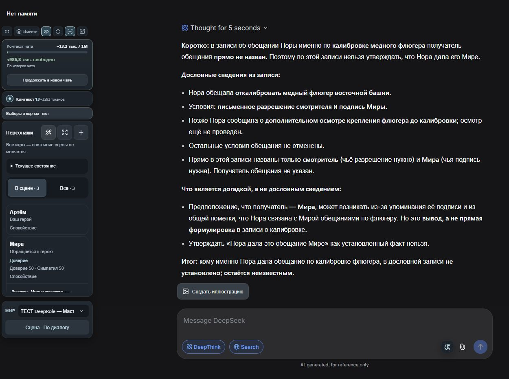

# RP345 — живой DeepSeek: память, активация и адресат обещания

## План и границы

Проверяли реальный DeepSeek в личном Edge, только вымышленный мир **«ТЕСТ DeepRole — Мастерская у моста»**. Пользователь разрешил живую проверку. Другие миры не редактировались, меню iframe не открывали. Выбранные записи памяти не переписывались. Установленный binary hash не проверен; console `revision:RP333` — диагностическая метка, а не доказательство версии установленной сборки.

До первой новой отправки закреплены12 вопросов и expected/mustNot: [план](benchmarks/rp345-live-plan.json), SHA256 `903ab2bac35b2f18f3e1eee71c112266b8992933cf139ba91840147f4da1e07a`.
Отдельный [план чистого чата](benchmarks/rp345-clean-chat-plan.json) записан до его создания и отправки. Ожидания после результата не менялись. Точечное уточнение адресата зарегистрировано отдельно **после наблюдения**, это не независимый holdout: [план](benchmarks/rp345-attribution-plan.json).

[Полные вымышленные ответы и попытки](benchmarks/rp345-live-replies.json), [проверки и диагностика](benchmarks/rp345-verification.json).

## Старый тестовый чат:12/12 по закреплённым критериям

Чат [«Условия Норы»](https://chat.deepseek.com/a/chat/s/6cd8d028-3790-46f1-81d3-b269c50ff3e1).

| Проверка | Что увидели |
| --- | --- |
| Три действия за раз | Калибровка Норы, проверка Миры и передача ключа разделены по своим условиям. |
| Ложная готовность | Питание и доставленный пакет не закрывают обещания. |
| Свободное описание | «Медная штука наверху» связана с флюгером; все условия названы. |
| «Её обещание» | DeepSeek просит уточнить, о ком/каком обещании речь; ни одно не закрывает. |
| Старый допуск | Отменённый допуск не даёт доступ, питание не заменяет его. |
| Владелец | Смотритель — предположение Артёма, не подтверждённый владелец. |
| Если представить разрешения | Гипотеза не меняет игру; осмотр крепления остаётся отдельным условием. |
| Закрытое и открытое | Северный фонарь, питание, пакет отделены от невыполненных проверок/ключа. |
| Неизвестная катушка | Нет выдуманного владельца, отправки или истории предмета. |
| Английский составной вопрос | Все три цепочки сохранены; ответ на русском по языку мира. |
| Цитата завершения с отрицанием | Не становится сыгранным событием. |
| После обычного reload | Ключ у Норы, пломба не проверена, калибровка/проверка не начаты, все условия прежние. |

Это ручная смысловая оценка завершённых видимых ответов, не12 автоматизированных unit. Старый native чат уже содержит правильные ответы и может помогать модели. Поэтому эти12 не доказывают независимое качество retrieval на1024 structured facts.

## Новый чат: три отказа автоматической активации и один ручной контроль

Создан штатной кнопкой New chat: [«Нет памяти»](https://chat.deepseek.com/a/chat/s/85a73980-6550-44a5-8e44-7996b5d8a247). Мир выбран через видимую панель. Предложенную старую сжимку **не применяли** — выбрано «Не сейчас». В исходный вопрос не добавляли ни условий, ни gold-фактов, ни копию контекста.

1. Первый запрос ушёл без памяти: UI сообщил об изменившейся истории/мире; DeepSeek честно не смог восстановить цепочки.
2. Штатное «Продолжить здесь» и тот же вопрос тоже не добавили память. Console: navigation/activation `story-binding-conflict`, detail `activation-tab-inactive` (182/34ms).
3. После пользовательского выбора вкладки автоматический повтор снова получил `activation-tab-inactive` (56ms). Свежий inventory нашёл только один DeepSeek; API selected тоже вернул target602384770. Это расхождение наблюдений автоматизации и guard; конкретный механизм не доказан.
4. Для контроля пользователь **сам нажал Enter** в уже подготовленном поле и дождался ответа. Модель получила память и воспроизвела **все6 ожидаемых тематических условий**: обе цепочки флюгера, ключ/пломбу, выполненные отдельные дела, новый допуск и неизвестного владельца.

До ручного контроля в новом native чате были только вопросы и ответы «нет контекста»; правильного native ответа там ещё не было. Это подтверждает рабочую доставку тестового лора при ручной отправке, но не является гарантией произвольного поиска или актуальной версии установленной копии. Три ранних отказа сохранены, не превращены в успех. Active-tab защиту не обходили и не ослабляли.

## Найденная смысловая неточность

В ручном общем ответе модель добавила **«Нора обещала Мире/по флюгеру»**. Источник говорит, что Нора обещала откалибровать флюгер после разрешения смотрителя и подписи Миры; **получатель именно этого обещания не назван**. Подпись Миры и отдельное обещание ключа Мире не доказывают адресата калибровки.

После отдельного вопроса об источнике DeepSeek прямо признал: «получатель обещания прямо не назван», «нельзя утверждать, что Нора дала его Мире». Уточнение отправлено через documented tab typeText/pressKey; его успех уже в активированном чате **не доказывает**, что этот API решает активацию из фона. Это исправление ответа по запросу, не изменение кода DeepRole и не универсальное устранение домыслов модели.

## Состояние и доказательства

Мир и3 персонажа сохранены. UI показывает «Вне игры — состояние сцены не меняется», у Миры/Норы50 доверия и50 симпатии, прежние описания поз/целей/места. Видимых технических блоков в сообщениях после reload нет. Сырой DOM может содержать скрытый исходный wire; его наличие не равно визуальному префиксу. Raw DB/POST-аудит и проверка server token limit не проводились.

Всего17 реальных запросов:12 основных +3 автоматических отказа в новом чате +1 ручной контроль +1 уточнение адресата. Полные screenshots с личным sidebar и AX/console сохранены только в ignored `.output/rp345-*`; в Git включён только кроп тестового содержания без sidebar. Личные фото, ключи и другие миры не передавались. Тексты/табличные значения лора вручную не менялись.

## Что дальше

RP344 остаётся красным: его54 пары с пропусками и10 пропущенных предупреждений этим живым контролем не исправлены. Следующий шаг — ремонт RP344 с SEEN replay и прежними наборами; отдельно усилить source attribution для **неизвестного адресата обещания**, не угадывая из подписи/соседнего долга и не переписывая исторический V1. Большой personal structured-source live и RP-08 остаются открытыми.

Production src в RP345 не менялись; unit/UI/build не повторялись. Предыдущие9768/0/5 относятся к RP343. Source ZIP обновлён только документацией; пересборка/архив не обновляет установленный браузер автоматически. Push/merge не запрошены.
