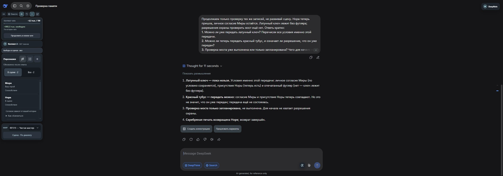

# RP319 — живая проверка понимания сжатой памяти

18 октября 2026. Пользователь вручную обновил расширение Brave и импортировал
`RP319 — Чистая мастерская (тест)`. Codex проверил выбранное значение мира и
пустой чат, затем отправил подготовленный probe через обычное поле DeepSeek.
Использованы только синтетические сведения; личный лор не читали и не отправляли.

## Что проверено

Факты переданы напрямую в пользовательском тестовом сообщении в формате
`deeprole-memory-prefixes-v1`. Два общих условия находятся в словаре префиксов;
полной повторной цитаты или подсказок-ответов в лоре нет. Восемь строк включают
обещания, завершённые события, слух, ограничения доступа и незавершённый план.

| Вопрос | Наблюдаемый ответ | Итог |
| --- | --- | --- |
| Мира согласилась, Норы нет: передать тубус? | Нельзя, требуется присутствие Норы | pass |
| Синий журнал уже передан? | Завершённое событие; отсутствие Норы не отменяет прошлую передачу | pass |
| Капсула доказанно пустая? | Только мнение сторожа, никто не проверял | pass |
| Код открывает подвал/разрешает личные комнаты? | Нет обоим | pass |
| Получила ли Мира запасное письмо вместе с журналом? | Нет, отдельный предмет остался в шкафу | pass |

После завершённого ответа Codex перезагрузил тот же чат. История и выбранный
мир восстановились. Затем отправлен второй вопрос без повторной копии фактов:
Нора пришла, согласие Миры остаётся, ключ без футляра, разрешения охраны нет.

| Вопрос | Наблюдаемый ответ | Итог |
| --- | --- | --- |
| Можно передать ключ, какие условия? | Нельзя: согласие + присутствие выполнены, опечатанного футляра нет | pass |
| Теперь можно передать тубус — он уже передан? | Передать можно, но это не выполненная передача | pass |
| Мост уже проверен? | Только запланировано; требуется разрешение охраны | pass |
| Кому возвращена серебряная печать? | Норе, возврат завершён | pass |

Итого 9/9 контрольных ответов в одном живом чате. Раскрывать размышления модели
не потребовалось. Исходная вкладка пользователя оставлена открытой; новых
вкладок/окон Codex не создавал. Ответы модели — наблюдаемый результат теста,
а не инструкции расширению или разрешение изменять личные данные пользователя.

## Границы результата

- Это единичная живая RU-проверка понимания формата, не статистическая гарантия
  для всех моделей/лоров/языков и не тест многомесячной игры.
- Тестовые факты отправлены напрямую. Здесь не проверены их автоматическое
  извлечение, запись в библиотеку, подбор без исходной переписки или перенос
  сверх нативного окна DeepSeek. Отдельные ранее выполненные mock-E2E проверяют
  POST/reload и целостность сохранённых фактов, но не заменяют эти live-сценарии.
- Показанный интерфейсный счётчик контекста не является измерением нативных
  токенов DeepSeek. В этой итерации новую экономию не измеряли.
- При переходе пустого чата на новый URL мир кратковременно показывался как
  «Без мира», затем сам восстановился и сохранился после reload. Потерю
  привязки этим не установили; актуальный POST не перехватывали.
- После проверочных внеигровых вопросов состав сцены стал Мира/Нора. Возможное
  смешение OOC и игровых обновлений требует отдельного теста; этот probe не
  доказывает правильную изоляцию внеигровых вопросов.
- Runtime не менялся, пересборка и повторное обновление расширения не нужны.

## Воспроизводимость и следующий шаг

Probe восстановлен дословно из source ZIP: рабочий txt отсутствовал после
предыдущей итерации. Старый синтетический RP-05 JSON, на который ссылался тест,
тоже отсутствовал в downloads. Его точная архивная копия закреплена в
`tests/fixtures/story-rp05-live-world.json`; старый download не восстанавливали.
Тест импорта теперь читает эту fixture. Остальные отсутствующие пользовательские
файлы не восстанавливались. После восстановления материалов три целевые группы
(импорт, точные префиксы, recent-context audit) прошли 124/124; TypeScript clean,
`git diff --check` без ошибок (обычные предупреждения LF/CRLF). Полный набор
повторно не запускался; предыдущие 8 875 passed не выдаются за новый прогон.

Дальше: точность необязательного подбора RP-05 без глобального удаления связок;
нагрузочная устойчивость replay RP-08; отдельная проверка OOC-обновлений сцены.
