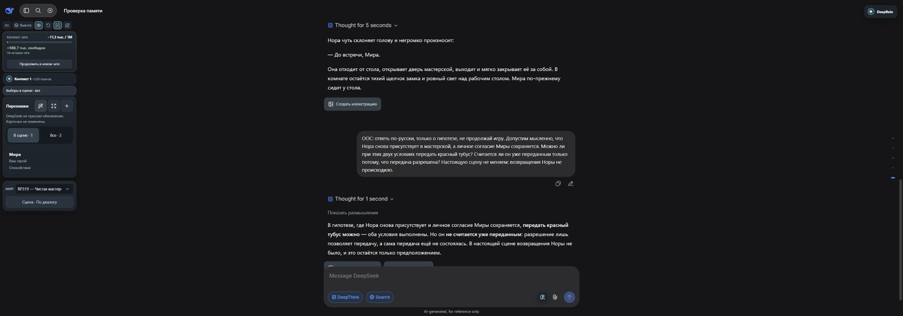

# RP320 — внеигровой вопрос читает память, но не меняет игру

## Причина и граница исправления

В RP319 живая модель правильно прочитала все проверенные факты, но после
проверочных вопросов видимый состав сцены изменился. В текущем поведении
непомеченная реплика считается игровой; из одного вопросительного знака
надёжно определить намерение автора нельзя. Ручная отметка «вопрос вне игры»
уже исключала пару сообщений из событий выбранной истории.

RP320 не добавляет угадывание смысла всех реплик. Признаются явные декларации
целого сообщения: `Вне игры: ...`, `OOC: ...`, `[OOC] ...`, целое `(OOC: ...)`
и отдельная команда `Не продолжай сцену` / `Не развивай сцену` /
`Do not continue the scene` в первом нецитируемом абзаце. Обычный вопрос
«Что Нора обещала?» остаётся игровой репликой. Смешанные сообщения с явным
возвратом `IC:` / `В игре:` не классифицируются автоматически. Цитаты, код,
Markdown-цитаты и декларации внутри позднейших абзацев данных не используются
как разрешение менять режим. Для остальных случаев остаётся ручная отметка.

Источник решения — только исходный текст локальной отправки и настройка автора.
Ответ модели, JSON внутри лора, недавняя переписка и уже сохранённые сообщения
не получают права задним числом объявить себя внеигровыми.

## Реализация

- Общий чистый распознаватель используется перед построением запроса и в
  транзакции сохранения исходящей отправки. Установленный `purpose` сохраняется
  для этой конкретной пары. Ручная одноразовая отметка потребляется как раньше.
  В installed-тесте дополнительно выявлено: снятие ручной отметки при prepare
  запускало обновление библиотеки и могло прервать собственный контекстный
  handshake. Теперь локальная отправка запоминает `consumeNonStoryMode:true`,
  а отметка снимается только при первой точной сверке исходящего текста.
  Неверная сверка её не снимает; повтор старого подтверждения не снимает новую
  отметку для следующего сообщения. Старые dispatch без поля читаются как раньше.
- Внеигровой контекст сохраняет подбор фактов, профилей, условий и источников,
  но не запрашивает обновление персонажей, сопровождение памяти, фото или
  четыре игровых хода. Отдельная обязательная инструкция включает режим чтения
  даже при выключенных карточках. Локальный бюджет учитывает её полностью.
- Обычный механизм выбранной истории исключает такую пару из игровых событий,
  новых фактов, дозаполнения профилей и пакетной обработки. Дополнительно старый
  обработчик карточек отклоняет обновление по сохранённой внеигровой отправке:
  совпадение request ID ИЛИ точная привязка native assistant ID, а не похожий текст.
  Удаление request ID из ответа не обходит эту защиту.
- Предыдущие сохранённые игры/анкеты не переписываются. Следующая обычная
  отправка снова игровая; внеигровой вопрос не включает постоянную паузу.

## Проверки

До исправления четыре проверки воспроизводили отсутствующий режим чтения и
неверный `user-turn`. После исправления добавлены проверки явных деклараций,
цитат, смешанных сообщений, точного чтения памяти на RU/EN, бюджета и запрета
старого обработчика применять обновления с request ID и без него. Существующая
проверка выбранной истории расширена на ручную отметку и декларации RU/EN.

Финальный полный прогон: 322 файла, 8 903 passed, 5 прежних todo, 0 failed;
TypeScript clean. Новая группа: 26/26, в том числе режим чтения с бюджетом 2000
на RU/EN. Installed Edge MV3 на синтетическом DeepSeek: 10/10 — шесть OOC-кейсов
(RU/EN × managed/legacy/manual) и четыре прежних metadata/prefix POST/reload.
Проверены actual POST, сохранность текста черновика, игнорирование неправильных
обновлений модели, неизменные люди/сцена/события после reload, OOC revisions
и действительное изменение сцены следующим обычным игровым ответом.
Тестовые контексты закрыты в finally; личный браузер не использовался.

Первый полный unit-процесс ещё видел ранний закэшированный распознаватель во
время добавления нового негативного кейса (1 fail); стабильный повтор прошёл.
Первый installed-тест выявил реальную гонку ручной отметки (исправлена); затем
один RU-кейс ошибочно задавал английский вопрос по русской smart-записи — язык
теста исправлен, алгоритм подбора не ослаблялся. Финальные 10/10 прошли вместе
без параллельного unit/build. Это не закрывает прежний нагрузочный кейс RP-08.

Chrome/Firefox/source ZIP подготовлены; Brave-пакет
`downloads/DeepRole-Brave-ooc-memory-20261018.zip` требует ручного обновления.

## Ограничения и дальше

### Live smoke после обновления Brave — выполнен

18 октября пользователь обновил расширение и оставил открытым тот же
`RP319 — Чистая мастерская (тест)`. Codex подтвердил выбор мира, исходный состав
Мира/Нора и отправил три сообщения через обычное поле DeepSeek:

| Сообщение | Ответ и видимый состав | Итог |
| --- | --- | --- |
| `Вне игры:` — предположим, что Нора ушла; можно передать тубус? | Нельзя без Норы, уход лишь гипотеза; 2 → 2 | pass |
| Обычная игра — Нора прощается, выходит, Мира остаётся | Сцена отыграна, карточка Норы исключена; 2 → 1 | pass |
| `OOC:` — предположим, что Нора вернулась; можно передать, уже передано? | Можно в гипотезе, но передача не совершена; 1 → 1 | pass |

После перезагрузки сохранились выбранный мир, история и одна Мира в сцене.
В DOM восстановленной страницы прочитаны исходные технические префиксы обеих
OOC-реплик: `<deeprole_read_only>` присутствует, игровые update/choice режимы
не добавлены. У обычного хода снова игровой character/choice режим. Это
проверка readback страницы, не перехват native POST. Предпросмотр OOC показывал
726 оценочных токенов вместо 1387 у пустого обычного draft; это разные режимы,
не универсальная оценка экономии или измерение нативных токенов DeepSeek.

Важно: в предпросмотре этого нейтрального мира 0 игровых фактов, 2 фрагмента
анкет, 0 фрагментов предыдущего чата. Условия тубуса были в прежней переписке;
этот тест не доказывает новое автоматическое извлечение/хранение этих фактов
или использование вне нативного контекста. Full DB до/после live не сравнивали.
Контроль неправильных модельных обновлений и stored events относится к ранее
пройденному installed mock-E2E, а не к этому живому наблюдению.

Снимки: [до](benchmarks/rp320-live-before-20261018.jpg),
[первый OOC](benchmarks/rp320-live-ooc-20261018.jpg),
[игровой уход](benchmarks/rp320-live-game-20261018.jpg).

Новых вкладок не создавали; оригинальная вкладка оставлена открытой, черновик
пуст. Менялся только синтетический тестовый сюжет: Нора теперь ушла. Runtime
не редактировали, сборки/полный unit-прогон заново не запускали; архив RP320
содержит прежний проверенный код, а его документация предшествует live-результату.

UI-замечания: ожидаемый OOC-ответ показывает «DeepSeek не прислал обновление»
вместо ясного «вне игры — состояние сохранено»; под ним остаётся ручная кнопка
«Предложить варианты». Это отдельная следующая задача; не исправлена в тестовом
запуске и не является потерей/самопроизвольным изменением карточек в этих кейсах.

Это не автоматический классификатор произвольных внеигровых намерений. Для
смешанных/неявных запросов нельзя обещать правильное угадывание. Успешный
live-probe RP319 не считается live-проверкой изменения RP320: выше описана
отдельная проверка после нового ручного обновления пользователя.

Дальше — OOC UX по точной принадлежности ответа; затем точность необязательного
подбора RP-05 и нагрузочная устойчивость replay RP-08. Личные миры не использовать.
