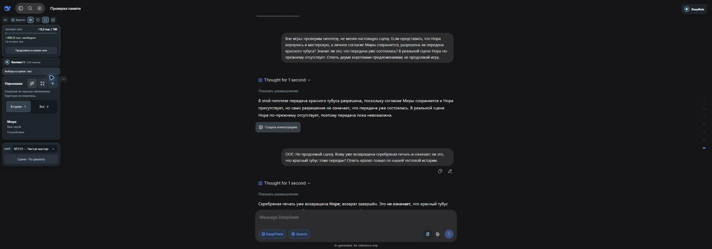

# RP321 — понятный статус OOC и поиск без помех от префикса

## Что изменено

После подтверждённого внеигрового ответа панель показывает:
«Вне игры — состояние сцены не меняется» / «Out of character — scene state is
unchanged». Старая плашка об отсутствии обновления остаётся для обычного ответа
без данных. Не скрываются реальные неизвестные/неподтверждённые ошибки.

Назначение ответа определяется чистой read-only функцией `storyReplyPurpose`:
одна валидная локальная принятая отправка, завершённая native-пара и точный
assistant ID, совпадающие мир, binding и чат. Virtual-list ID приводится к
эквивалентному native message ID. Не используются похожий текст, слово OOC в
ответе модели, текущий черновик или порядок записей. Неизвестное, неоднозначное,
неполное и восстановленное подтверждение не получают специального статуса.
Это доказательство для отображения, не новая власть на запись истории.

Под таким ответом не создаются ручная кнопка «Предложить варианты» и карточки
вариантов, даже если модель их прислала. Исходный технический payload скрывается
прежним механизмом без изменения прозы; прямой запрос восстановления вариантов
тоже проверяет текущую native-принадлежность. Следующий обычный ответ получает
обычный статус и доступные игровые варианты. Обновление receipt повторно
проверяет видимый ответ; результат работает и после reload.

## Следующий шаг точности RP-05: префикс не меняет предмет вопроса

Контролируемая проверка на прежнем независимом сюжете RP316: 12 вопросов × RU/EN
× 2 обёртки (`Вне игры:`/`OOC:`, `[OOC]`) = 48 сравнений. Это не новый независимый
сюжет. До исправления в 14 случаях отличались контекст/выбранные данные или
отчёт относительно такого же вопроса в read-only режиме без обёртки. Этот
замер не означает 14 потерянных условий: проверялось точное равенство результата.

Внутри компилятора только для уже выбранного read-only режима удаляется
из поисковой копии явная обёртка. Исходный draft, транспорт, dispatch source,
цитаты и сохранённые факты остаются дословными. В поисковой копии связанных
character recent references меняется лишь тот же начальный draft; дальнейшая
переписка не переписывается. Для mixed/quoted/unmarked текста ничего не
удаляется; естественная команда не продолжать сцену не режется по предложениям.

После исправления все 48 контекстов и отчётов равны соответствующему обычному
read-only вопросу; входы неизменны. Включены вопросы о месте предмета, условиях
и позднем прогрессе обещания, раскрытии, разговорных повторах, неизвестном и
предлагаемом владельце. Нормальные игровые запросы не менялись. Глобального
удаления слабых/нулевых совпадений нет: такой кандидат RP318 ломал регрессии.

## Проверки и границы

Новые unit-проверки: точная принадлежность ответа, RU/EN подписи, отрицательные
случаи, исключение recovery/supplied choices, 48 сравнений и сохранность поиска
на цитатах/коде/mixed-вводе. Installed OOC E2E дополнен проверкой статуса,
отсутствия вариантов после reload, возврата к игровому статусу/кнопке, 200 px
панели и неизменных исходного draft/суффикса реального POST.

Полный regression: 324 файла, 8 975 passed, 5 прежних todo, 0 failed;
`.output/rp321-unit-final.json`. Целевой прогон 189/189; TypeScript clean.
Installed Edge MV3 на синтетическом сайте: 10/10 (6 OOC RU/EN × managed/legacy/
manual, 4 прежних metadata/prefix transport). Статус проверен до и после reload;
200 px RU/EN снимки просмотрены, строка переносится без горизонтального выхода.
Снимки: `docs/benchmarks/rp321-ooc-{ru,en}-narrow-20261018.png`.

Первый E2E-прогон обнаружил ошибку стенда: reload всегда рисовал начальный ID 41,
даже когда server selection был 43. Исправлено отображение выбранного ответа;
дополнительно стенд ждёт сохранённого finish перед навигацией и проверяет статус
до неё. Проверки принадлежности runtime не ослаблены ради старого неверного DOM.
Chrome/Firefox/source и ZIP — текущая секция ROADMAP/CODEX-HANDOFF.
Старая живая проверка RP320 не считается проверкой нового UI.
В реализации личные миры и открытый Brave не использовались. Последующий
live smoke после ручного обновления описан ниже и выявил отдельный дефект.

## Live smoke после обновления пользователя — НЕ ПРОЙДЕН

Тот же мир RP319, Нора вне сцены, Мира в сцене. Две новые тестовые пары:
RU «Вне игры:» с гипотетическим возвращением Норы и EN-маркер `OOC:` с вопросом
о серебряной печати. Ответы правильно сохранили условия/различие предметов и
разрешения с выполнением; карточки 1 → 1. Но новая нейтральная плашка не
появилась: остались missing и «Предложить варианты». Reload не исправил UI.

Readback восстановленных user rows 11/13 показал `<deeprole_read_only>` и
read-only character reference. Их assistant rows 12/14 не классифицируются по
своим словам. Это не сетевой перехват или full-DB сравнение. Новые факты в
нейтральный мир не импортировались; верные ответы не доказывают auto extraction.

Старая дата в панели доставки не означает, что инъекции не было: существующий
`memoryDeliveryView` намеренно исключает OOC purpose. Нельзя делать по ней вывод
об отсутствии новых dispatch. Конкретный native transport живого клиента не
установлен. Пробел покрытия: только XHR в OOC E2E и metadata-only stream observer,
тогда как `storyReplyPurpose` требует finished native link. Fetch следует
проверить следующим, не объявляя его причиной без доказательства.

Обычный игровой ход на этой стадии не отправлялся. Дальше — установить причину,
добавить regression, исправить и повторить live до перехода к другим сюжетам.
Код/архивы после диагностики не менялись. Исходный чат оставлен без черновика,
служебных окон не создано. Снимок:
.

Дальше — точность необязательного подбора на разных сюжетах/бюджетах; отдельный
нагрузочный replay RP-08 всё ещё открыт. Не урезать память глобальным фильтром
без проверки условий, разных владельцев, продолжений и редких формулировок.
